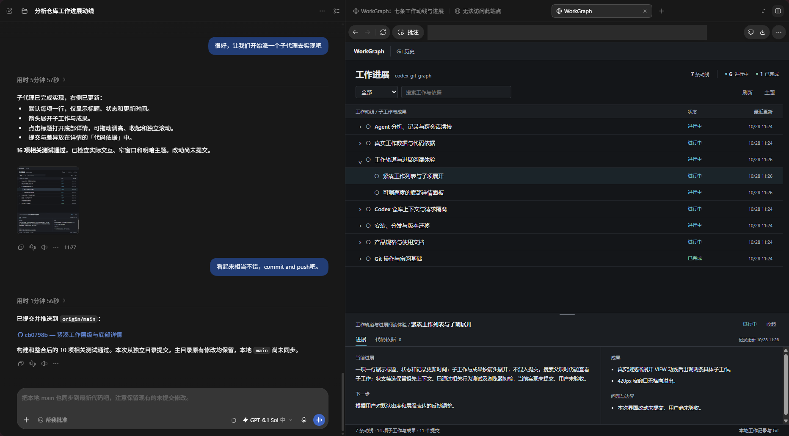
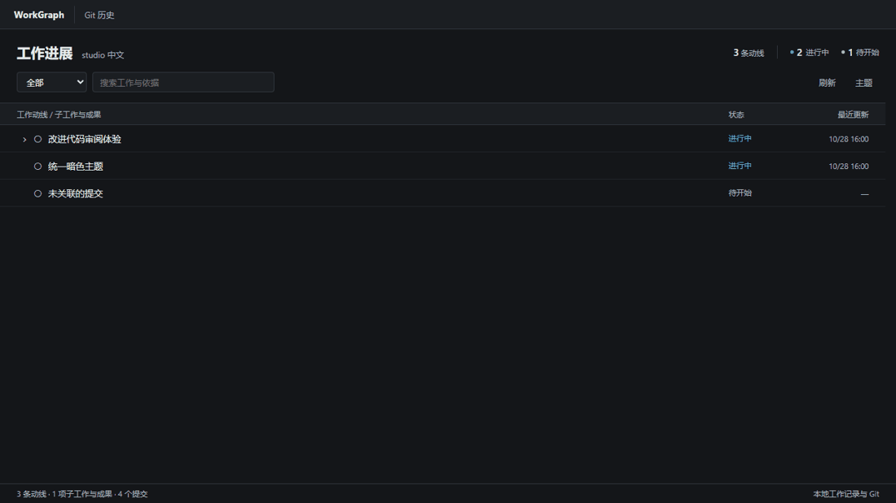
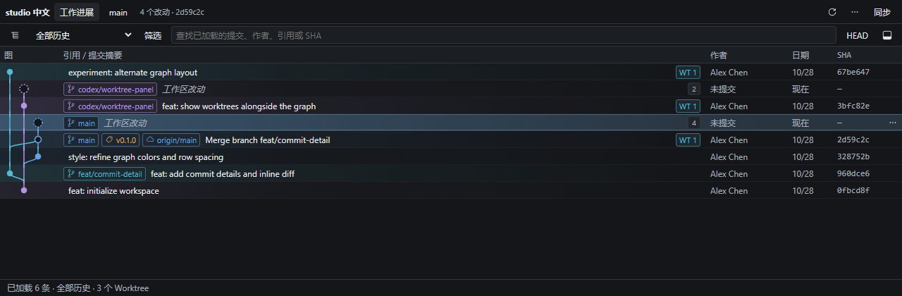

# WorkGraph

WorkGraph 是一个在 Codex 中使用的本地仓库面板。打开「工作进展」，可以查看每项工作做到哪了、接下来做什么，以及对应的代码改动；切换到「Git 历史」，可以查看提交图、审阅差异和操作仓库。



在聊天里让 Codex 整理仓库的工作记录，然后在右侧面板中查看。记录可以展开到子工作和成果，点击标题就能打开详情。

下面用示例仓库演示：展开工作，打开子项查看进展，再从「代码依据」进入关联提交，查看实际差异。



## 什么时候用

- 隔了一段时间回来继续开发，先看工作状态、下一步和还没解决的问题，再展开具体子工作。
- 想核对一项工作改了什么，打开「代码依据」查看关联提交和差异。未提交文件会单独列出。
- 需要检查分支和合并历史，切换到「Git 历史」查看提交图、标签和多个 Worktree，定位 HEAD，或比较两个提交。
- 准备提交代码时，逐文件检查差异、暂存并创建提交。面板也支持管理分支、标签、Stash 和远程仓库，以及创建新 Worktree。



上图使用示例仓库。提交图中的连线表示 Git 提交的父子关系。

本地历史读取不需要 GitHub 或 GitLab 登录；远程同步使用本机 Git 的现有认证。

<a id="开始使用"></a>

## 第一次使用

### 1. 启动面板

需要 Node.js 22+、npm 和 Git。当前实测环境为 Windows；其他平台尚未验证。

将最后一行的路径换成要查看的仓库，然后在终端运行：

```powershell
git clone https://github.com/Daoming-Chen/codex-work-graph.git workgraph
cd workgraph
npm install
npm run build
npm start -- --repo "D:\path\to\repository"
```

在 Codex 右侧浏览器中打开终端输出的完整链接。使用期间保持服务运行，结束后按 Ctrl+C 关闭。

也可以按[本地插件安装说明](docs/install-lifecycle.md)配置插件，通过聊天打开面板。目前提供源码构建和本地 marketplace 配置，桌面应用中的插件安装流程还需要验证。

### 2. 让 Codex 整理工作记录

在目标仓库的 Codex 聊天中发送：

> 分析这个仓库，把各项工作的进展、下一步、成果和问题整理到根目录的 `.workgraph.json`。先读已有记录，再核对源码、Git 提交和实际验证结果。保留已有工作项的 ID 和依据；无法确定归属的提交不要关联，没有执行的验证不要写成通过。

Codex 会把整理结果写入文件，面板再从文件读取。你也可以自己维护记录，格式和提交关联规则见 [WorkGraph 使用说明](docs/work-graph.md)。没有工作记录时，面板只显示未关联的提交历史。

### 3. 刷新、展开，再查看代码依据

1. 在「工作进展」点击「刷新」，读取最新记录和 Git 数据。刷新只读取数据，不会让 Codex 重新分析仓库。
2. 点击行首箭头，展开子工作与成果。工作较多时，可以按状态筛选，或搜索工作与依据。
3. 点击工作标题，在底部「进展」中查看摘要、下一步、成果和问题。
4. 切换到「代码依据」，检查关联提交与实际差异；需要查看分支或更完整的历史时，点击顶部「Git 历史」。

工作记录需要由 Codex 或人工更新，目前没有后台监控、自动记录、恢复点或自动验收。记录中的「已完成」也不代表验证通过或用户验收。

工作视图默认读取当前工作区的 `.workgraph.json` 和 HEAD 最近 300 条提交，详情中只统计这次加载到的关联提交。

## 使用前了解

面板可以修改仓库和远程引用。执行前需核对目标仓库、Worktree、分支和操作摘要；删除、丢弃及部分历史重写操作需要明确确认。打开面板本身不代表授权写入。

- 不提供普通强制推送、交互式 Rebase 编辑器或 Worktree 删除。冲突内容需在外部编辑器修改。
- 查找只覆盖已加载的提交；文本预览和 diff 最多显示 256 KiB。
- SSH、WSL 和跨主机访问尚未验证。回环链接指向服务所在机器，不要公开服务或创建公网隧道。
- MCP Apps 原生入口和随聊天切换仓库的行为取决于宿主，不能保证在所有 Codex 版本中可用。

## 文档与贡献

- [安装与打包](docs/install-lifecycle.md)
- [使用指南](docs/usage.md)
- [WorkGraph 工作记录与数据边界](docs/work-graph.md)
- [故障排查](docs/troubleshooting.md)
- [贡献指南](CONTRIBUTING.md) · [架构与安全边界](docs/current-implementation.md)
- [项目开发视图产品概念](docs/project-development-concept.md)（规划，待细化）

## 许可证

仓库目前未提供项目 LICENSE，不能据此认定已授予开源使用、修改或分发许可。第三方素材的声明见 [THIRD-PARTY-NOTICES.md](THIRD-PARTY-NOTICES.md)。
