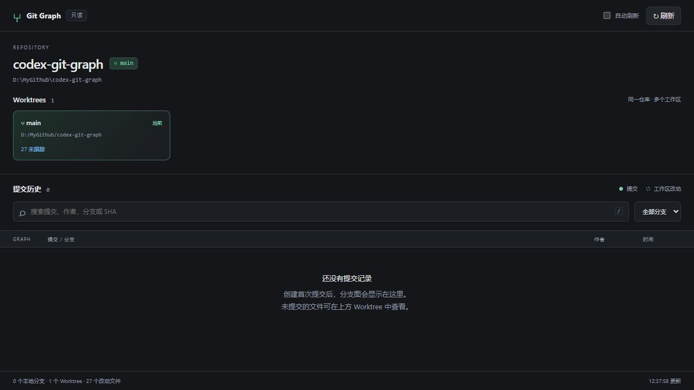
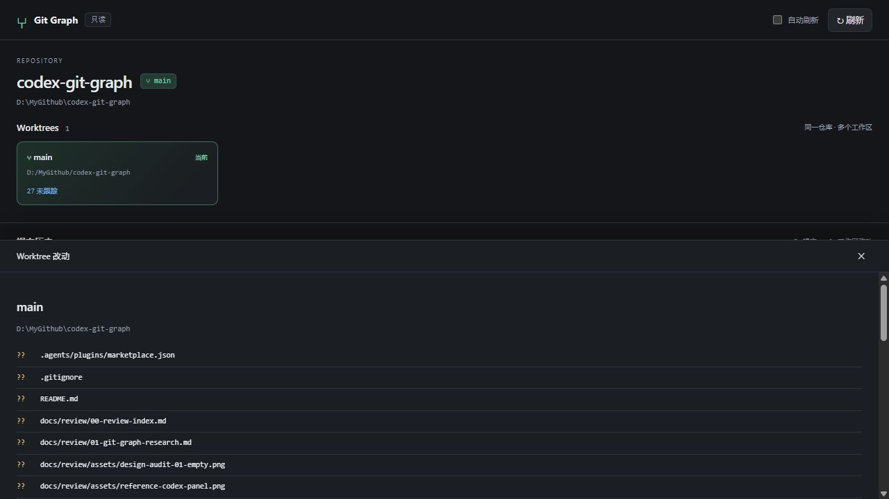

# Codex Git Graph 产品设计

日期：2026-10-26。设计：GPT-6 Astra。输入：[行业调研](01-git-graph-research.md)、用户 GitLens 参考、当前产品截图及源代码。交付是第二阶段设计决定；不代表第三阶段已经实现或验证。可审阅布局见 [交互线框](04-design-wireframe.html)，实现约束见 [实现规格](03-implementation-spec.md)。

## 定位和核心任务

在 Codex 右侧持续查看仓库的真实历史与多个 Worktree，审阅修改并完成一次本地提交。图表回答「修改来自哪里、当前在哪里」；文件详情回答「具体改了什么」；少量明确操作回答「下一步怎么做」。不把用户当 Git 专家，也不隐藏分支、提交、index、父提交等真实对象。

典型流程：

1. 打开当前仓库，看当前工作区未提交文件及 HEAD；全仓库图仍在旁边。
2. 点提交、引用或另一个 Worktree，检查其文件和差异；浏览其他工作区不会切换 Codex 聊天或工作目录。
3. 将一组文件暂存，检查已暂存差异，填写消息并提交到明确的分支。
4. 从选中提交创建分支或新 Worktree，为下一项工作准备独立目录。
5. 选两个端点比较，理解实验分支与基线的内容差异，再决定后续动作；本轮不宣称自动判断可安全合并。

## 当前产品审阅

本阶段实际打开运行中的页面，捕获并重新打开以下截图。当前项目没有提交，因此本次实际流程只覆盖空仓库与未跟踪文件详情；分叉历史的判断来自用户参考、阶段一报告和代码，不冒充实测。

### 步骤 1：打开仓库，主要任务入口偏弱

1280 × 720 截图中，图表表头开始于约 y=425；前方大标题、Worktree 卡片和分隔占去过半屏。空状态让用户返回上方卡片查看文件，图本身没有 unborn 工作区节点。状态文字和真实路径是优点，但最重要的「查看修改」入口分散。D01、D03、D09 修复这一问题。

### 步骤 2：打开工作区，读取成功，审阅链路中断

详情成功返回真实未跟踪路径，且清楚说明未读取内容；这是诚实的限制。但文件不可选择，没有文件级 diff，长清单把后面的差异区推到下方，无法完成审阅和提交。底部覆盖层还遮挡历史。D04、D07、D08 改为可选择文件、独立滚动和真实本地操作。

可见无障碍风险：次要说明字小、路径只靠颜色和符号传达状态、详情打开后焦点仍在原卡片；需实现阶段验证焦点、键盘导航、对比度和缩放，不能凭截图声明符合 WCAG。

代码依据：`src/ui/app.js` 将分支「筛选」实现成变暗，行高为 44px，详情一次拼接整份 patch；`src/git.mjs` 已有真实状态、引用和 Worktree 解析；`src/http.mjs` 仅有 GET 查询。既有安全边界和图布局可复用，UI 与读写接口需要扩展。

## 宿主能力核实

本阶段通过 OpenAI Docs 搜索后实际打开 [Plugin Extensions](https://developers.openai.com/plugins/build/extensions) 和 [MCP server and UI quickstart](https://developers.openai.com/plugins/build/app-quickstart)。前者描述 ChatGPT 扩展及 thread entrypoint；后者确认工具可向 ChatGPT 和 Codex 暴露能力，UI 使用 MCP Apps bridge。两页不证明此机器上的本地 stdio 插件会获得 Codex 原生永久工具按钮。

| 层次 | 已有证据 | 产品决定 |
| --- | --- | --- |
| Git 能力 | Node 服务调用本机 Git，可读历史、状态、diff | 本地 Git 写入可自行实现，不依赖假想宿主 API |
| MCP Apps | `server.mjs` 注册 UI resource、工具及 thread entrypoint；`app.js` 使用 App bridge | 保留同一 UI 双传输；原生入口仍标记待安装验证 |
| 右侧浏览器 | Codex 右侧内置浏览器已通过 CUA 实际打开并操作；`open_in_codex` 为已知工具与技能预期路径，本轮未单独调用验证 | 作为本轮可验收入口；插件技能显式传入聊天仓库路径 |
| 宿主上下文 | 工具调用能带路径；未验证第三方 UI 获取任意聊天/代理状态的通道 | 不显示运行中代理、聊天绑定、自动随聊天切仓库、切换聊天按钮 |
| 远程环境 | 回环 URL 仅代表服务所在主机；未实测 SSH/WSL 转发 | 不承诺跨主机；不创建公网隧道补偿 |

实际 Codex 工具存在，不代表自定义页面自动持有这些工具权限。原生入口验证失败不得阻断已验证浏览器入口，也不得用外观模拟宿主按钮。

## 决策记录

| ID | 决定 | 原因与取舍 |
| --- | --- | --- |
| D01 | 两行工具栏 + 28px 连续提交表，删除大标题和 Worktree 卡片 | 对齐 GitLens 的历史密度；不用营销式卡片包装开发工具 |
| D02 | 默认全仓库拓扑，当前工作区作为操作上下文 | 看全局和改当前目录不是同一概念；选择其他提交不隐式改变操作目标 |
| D03 | Worktree 导航 + 与各自 HEAD 相连的虚拟 WIP 行 | 历史提交按 SHA 去重，脏工作区各有一行；干净工作区在 HEAD 引用旁可定位，不制造假提交 |
| D04 | 详情使用布局内分区；窄宽度可放大详情并返回历史 | 不覆盖选中行；保留选择、滚动与文件位置，避免长 patch 冲走文件入口 |
| D05 | 搜索是已加载范围内查找；分支范围是真正服务端可达历史过滤 | 两者分开命名。搜索只高亮命中；范围更换重算拓扑。禁止把变暗叫过滤 |
| D06 | 引用导航、定位 HEAD、两端点比较均进入本轮 | 减少手工抄 SHA。比较采用 A → B 的树差异，不暗示 merge 或冲突结果 |
| D07 | 每个文件独立读取 diff；未跟踪文本可预览 | 现有整份 patch 不适合审阅。限定大小、二进制、符号链接和子模块有明确状态 |
| D08 | 本轮提供暂存/取消暂存、提交、创建分支、干净工作区切分支、创建 Worktree | 完成本地审阅与隔离工作的闭环；不是继续只读。每项都有前置检查和具体目标 |
| D09 | unborn、detached、locked、prunable 分别表达 | 没有提交仍能审阅和首次提交；锁定不等于只读；失效目录不能伪装干净 |
| D10 | 写入使用显式对象、执行前重新检查与操作结果记录 | 代理/用户可能同时修改 Git。UI 快照不是事务，也不宣称能够消除所有外部竞争 |
| D11 | 保留现有深灰/绿色配色，减少圆角与装饰；支持浅色和系统主题 | 延续代码现有 tokens，视觉参考来自 GitLens 密度；图线是数据可视化，不生成装饰图片 |
| D12 | 不展示假功能、假代理状态或「自动接入 Codex」承诺 | 缺少后端/宿主通道的动作不出现在产品按钮中；后续计划只留文档 |

## 布局和信息层级

第一行 40px：仓库名、活动 Worktree 下拉、分支/HEAD、修改数、刷新、更多。仓库路径在下拉和详情中完整可复制，不长期占行。第二行 36px：导航开关、范围下拉、查找、命中导航、定位 HEAD、详情开关。操作多时放菜单，不让工具栏挤出屏幕。

引用导航包含 Worktree、本地分支、远程分支、标签；组可折叠，行高 28px。宽屏默认显示 184px，侧边面板默认折叠。图表同一行对齐图线、引用和摘要、作者、相对日期、短 SHA。复杂拓扑允许图区域内部横向滚动，不能压扁、截掉父边或把不同分支合成一条线。

默认选择：当前工作区有修改则选 WIP；否则选当前 HEAD。空仓库选「工作区 · 尚无提交」。选中提交不改变活动 Worktree；在 Worktree 菜单点击「设为操作工作区」才改变面板内目标，并显示路径。这一动作只改变面板上下文。

详情先显示对象、父提交或比较端点，再显示文件分组和选中文件的统一 diff。提交面板只提交 index；按钮为「提交已暂存的 N 个文件」。没有自动选择全部文件、自动生成提交信息、自动 push。自然语言帮助解释「暂存：选择本次提交包含的修改」，不替换 Git 术语。

## 本轮与后续分期

P0 是可读且可靠的图、工作区和文件审阅，P1 是本轮必须一起交付的浏览效率与本地写操作；不能将 P1 误读为可省略的愿望清单。具体列表和测试矩阵在 03。

后续 P2：fetch、明确 remote/目标分支的 push、仅快进 pull、stash、Worktree 删除/锁定管理；需要独立的凭据、网络超时、冲突和恢复流程。后续 P3：merge/rebase/cherry-pick/revert/reset/discard/clean、force push、文件历史、reflog、PR/CI、经过验证的宿主关联。首批延后远程操作，是为了先交付本地闭环并避免未经设计的认证/冲突路径，不是因为用户要求只读。

本轮明确不做：自动合并判断、minimap、自然语言搜索、分支拖拽重写历史、代理状态推测、聊天管理、内置终端、文件编辑器、网络托管集成。没有对应入口或灰色占位按钮。

## 交接约束

开发写操作不等于授权在用户真实仓库执行它们。本轮验收的提交、暂存、切分支、创建 Worktree 等只能在独立临时测试仓库中执行，不改变当前项目历史。最终报告须按 D01–D12 逐项说明实现位置、验证证据与剩余限制；偏离设计时记录实际原因，不静默降级。
