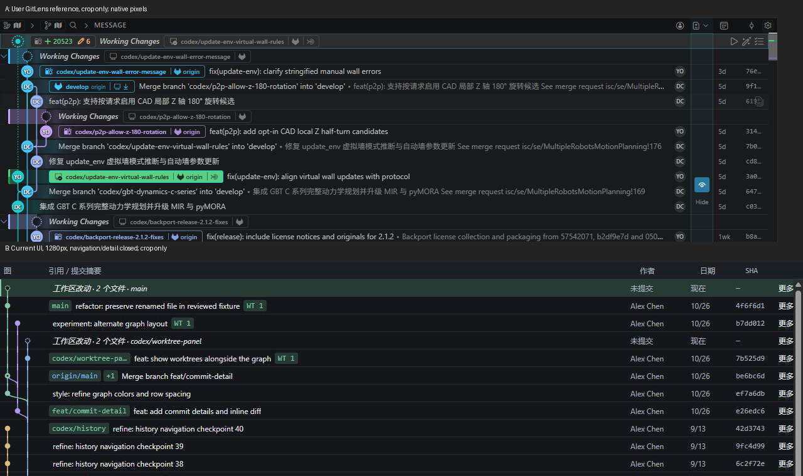

# GitLens Git Graph UI 对照审查

日期：2026-10-26。审查模型：GPT-6.1 Sol。范围：v0.2.0 当前预览与用户提供的 GitLens 截图。仅记录与建议，未修改产品代码。

## 结论

当前界面已经具备连续提交图、行内引用、WIP、作者/日期/SHA 列与文件差异，但视觉中心仍是「灰绿表格与操作面板」。用户参考的中心则是「由作者节点、彩色引用和细密图线组织的提交历史」。优先调整历史区占比、节点与引用、行高和选中色，比增加更多按钮更能接近用户偏好的 GitLens。

这不是以个人偏好评分，也不把上一轮设计决定当成不可改变的约束。28 px 行高、灰绿配色、宽屏导航与详情同时显示属于既有设计选择；420 px 的摘要与操作拥挤属于实现问题。两类问题应分别处理。

## 来源与证据

- 第一视觉基准：[用户提供的 GitLens 原图](assets/reference-gitlens.png)。这是用户已提供的参考，不代表当前最新版，也不代表本轮实际操作过 GitLens。
- 本轮产品证据均由正在运行的 fixture 预览经 CUA 重新截图；未使用旧 v2 截图作为本轮验收证据。保留原预览服务，没有新建服务或操作真实仓库。
- 本轮原始截图：01–08，见下表。使用相同 fixture、相同 merge 提交排除内容差异。视口为 CSS 像素；GitLens 原图的宿主缩放和系统 DPI 未知，跨产品数字只能作为视觉估计。
- [原像素提交行对照图](assets/gitlens-compare-pair-rows.png)：仅裁切原图并上下拼接，未缩放或重绘；用于同时观察行高、头像、引用、选中和操作列。保留两张原图。
- 读取当前 `src/ui/style.css` 和 `src/ui/app.js` 只用于确认已观察到的原因，不以源码替代视觉证据。根目录不存在 `.codegraph/`，按项目规则跳过 CodeGraph。

## 三轮复核记录

| 轮次 / 步骤 | 目的与动作 | 证据 | 状况 |
| --- | --- | --- | --- |
| 1 / 01 | 1280 × 800 初始 WIP，检查导航、历史、详情占比 | [宽屏 WIP](assets/gitlens-compare-01-wide-wip.png) | 稳定；历史被两侧面板压缩，作者/SHA 隐藏 |
| 1 / 02 | 同宽关闭导航与详情，检查完整历史表 | [宽屏历史](assets/gitlens-compare-02-wide-history.png) | 稳定；作者/SHA 恢复，排除功能缺失误判 |
| 2 / 03 | 选择 merge 提交，核对节点、引用、选中、父比较和文件 diff | [提交详情](assets/gitlens-compare-03-commit.png) | 稳定；可见双父选择器和 detail.js diff |
| 2 / 04 | 打开该行更多操作，仅观察后关闭 | [操作菜单](assets/gitlens-compare-04-menu.png) | 可用；当前为居中模态窗，竞品菜单无对等证据 |
| 3 / 05 | 同一 merge 提交切换 640 × 800 | [640 提交](assets/gitlens-compare-05-640-commit.png) | 详情移到底部，日期保留；元信息区需要滚动 |
| 3 / 06 | 同一提交切换 420 × 800，等待稳定重拍 | [420 提交](assets/gitlens-compare-06-420-commit.png) | 摘要/操作拥挤；作者、日期、SHA 隐藏 |
| 3 / 07 | 420 打开引用导航 | [420 导航](assets/gitlens-compare-07-420-navigation.png) | 导航覆盖大部分历史；能关闭返回 |
| 3 / 08 | 960 × 800 浅色主题，同一提交 | [960 浅色](assets/gitlens-compare-08-960-light.png) | 结构差异仍在；完成后恢复深色并重置临时视口 |

第一轮：先比较整体层级，明确不能把「1280 窗口」误当成「1280 历史区」。01 历史区约 736 px，02 为近全宽。用户参考在约 1265 px 的窗口里，提交图横向占主要空间，未展示同样的两侧面板。

第二轮：在原像素对照图中逐项复查提交行、图线、节点、WIP、引用、作者、日期、SHA、选中和边界。已确认当前 merge 连线连续，未发现断线证据；不能因 fixture 的单作者、少分支而判定算法不如竞品。

第三轮：固定 merge 选择复核宽度，验证窄屏字段隐藏和详情下移属于响应式行为；再用浅色主题确认节点、标签与行末操作差异并非仅由深色配色造成。第一次紧接 resize 的 420 截图出现过渡缩放，已拒收并由稳定截图覆盖；报告只引用稳定文件。

## 按视觉影响排序的差异

### 1. P1：历史区默认占比不足，改变了产品的视觉中心

证据：01 中左导航 184 px、右详情约 360 px，1280 宽下历史约占 58%；02 关闭两侧后作者与 SHA 均出现。GitLens 参考的提交表横向延伸至右侧，仅有窄图标栏。

影响：同样宽度下，当前界面更像三栏工作台，用户参考更像历史表。作者/SHA 不见是布局挤压，不能写成尚未实现。

建议：宽屏提供并记住「历史优先」布局；导航默认折叠或按需打开；点击提交后优先底部详情，允许恢复侧边。先在 1280 宽验证摘要可读宽度与信息列，再决定断点。Codex 真正窄侧栏仍需保留下方详情和渐进隐藏列，不能照搬竞品全宽工作台。

性质：既有设计选择，可根据用户的新偏好调整；不是图线缺陷。

### 2. P1：节点缺少作者头像，是最显眼的行级差异

证据：对照图 A 的节点包含 YO/DC 等圆形头像/缩写，WIP 为较大虚线圆；B 的普通节点是小实心圆，merge 为小空心结构，WIP 为微小虚线圆。当前右侧作者为重复姓名文字，参考右侧则是紧凑头像。

影响：参考图可以沿节点同时追踪拓扑与作者；当前需要在左右两处读图与姓名，图本身更像抽象折线。

建议：先做 16–18 px 的作者缩写圆节点与 18–20 px WIP 虚线环试验，保留 lane 颜色边缘；真实头像需要明确来源和失败回退，不能凭空生成作者图像。现有 lane 间距 16 px，增大节点必须同步检查相邻节点碰撞，可试 18 px lane 间距。数字是建议初值，并非从参考图精密反推的像素规格。

性质：展示能力与设计选择差异，不是 fixture 只有一位作者导致的假差异。

### 3. P1：引用标签的语义与颜色过于单一，复合关系被折叠

证据：A 同一引用框含分支名、提供方图标、origin、同步状态，且青/蓝/紫等颜色与分支视觉相关；B 本地分支普遍灰绿，remote 仅换蓝色文字。03 的 merge 行直接显示 `origin/main +1`，其余引用需另开；02 的 `codex/worktree-panel` 即使历史全宽仍截断。

影响：GitLens 的分支标识本身就是图的重要锚点；当前标签更像通用元数据。宽屏永久 130 px 上限和仅显示一个引用，使窄屏策略侵入宽屏。

建议：将本地分支、remote、tag、Worktree 标识分为稳定的图标与文本层；同提交的本地/跟踪远程可组合，但必须基于真实关联。宽屏允许更长标签、展示 2–3 个短引用，窄屏再压成计数。颜色可沿分支/lane 系统建立映射；选中底色与引用色应分离。tag 使用专门图标/色型，不凭本轮截图推断 tag 一定缺失。

性质：既有展示选择；当前 fixture 的 tag 位于较早提交，本轮未滚到该行，因此未验证其实际行内渲染。

### 4. P1：行密度与图线节奏仍偏疏

证据：A 的可见提交行约 24 px；B 实测并由样式确认 28 px，普通节点半径 3.5 px、线宽 1.5 px。对照图同高度区域 A 容纳更多历史。当前字体为 12 px，本身并不需要继续缩小。

影响：约 17% 的行高差会直接改变长历史的扫读节奏。减少字号无法替代行距调整，反而可能降低可读性。

建议：增加 24 px 紧凑行密度选项；行、SVG 高度、节点中心与曲线控制点统一用密度参数，避免只改 CSS 后线段断开。当前 merge 圆角连接已连续，应保留拓扑稳定性。需要多分支压力 fixture 后再微调曲率，不先重写算法。

性质：28 px 属于既有设计选择；本轮没有确认 merge 错接、断线或 lane 跳动缺陷。

### 5. P1：绿色大面积选中态与参考低饱和选中行不一致

证据：01 WIP、03 merge 的整行绿色块和左侧绿色强调线；A 选中 WIP 为灰蓝低饱和背景与细蓝边，彩色引用仍是视觉重点。08 浅色也使用绿底，说明是主题 token 的共同策略。

影响：当前选中态、分支标签、工作区改动、diff 增加行共享绿色语义，容易把「选中」与「改动」混为同一视觉层。

建议：深色选择底先试中性灰蓝（如 `#283238`），配细边；分支颜色和绿色成功/新增语义独立。不要直接声称该色值就是 GitLens 原值。保留键盘焦点可见性，选中与焦点应可区分。

性质：灰绿 tokens 的既有选择，不是渲染错误。

### 6. P1：每行常显「更多」形成重复噪声，420 px 暴露拥挤问题

证据：02 每行最右都重复「更多」；A 行尾是紧凑图标/状态，选中 WIP 附近才出现一组显著操作。06 中分支长名、WIP 文案、摘要末尾紧贴「更多」，部分行缺乏清晰间隔。

影响：宽屏重复动作抢走视觉注意，窄屏又持续占用有限摘要宽度。

建议：改为固定 24–28 px 的省略号图标列，桌面悬停/选中/键盘焦点时显示；触摸/窄屏保留可发现入口。为摘要与操作保留至少 6–8 px 间距，并验证长分支、WT 徽章和长中文摘要组合。不能简单隐藏按钮而破坏键盘操作。

性质：常显文案属于设计选择；420 px 的间距/挤压属于可复现实现问题。GitLens 参考没有展示其菜单打开状态，因此不将当前居中模态窗判定为竞品不一致缺陷。

### 7. P2：WIP 行缺少结构化状态徽章，文字承担过多信息

证据：A 使用虚线节点、斜体 Working Changes、工作区/分支图标及数量状态；01/06 主要是斜体「工作区改动 · 2 个文件 · main」，还与普通提交共享日期/操作列。

影响：当前虽能识别 WIP，但状态扫描依赖读整句；窄屏分支名和摘要互相竞争。

建议：保留斜体 WIP 语义，将数量与 Worktree 标识做紧凑独立徽章；本地分支名用同一引用组件，不复制成无边界长句。工作区的 staged/unstaged/冲突数应来自真实状态，不能照抄参考图的状态字段。

性质：表现层差异；现有每个有改动 Worktree 一条 WIP、可点击查看文件/diff 的行为应保留。

### 8. P2：工具栏偏表单化，缺少参考图的紧凑图标层级

证据：当前两行工具栏由「刷新、更多、导航、HEAD、详情、上一个、下一个」有框按钮构成；A 使用窄图标组、一个主要搜索输入和少量数字状态。A 另有活动概览、引用条、仓库健康横幅，当前没有。

建议：先统一 24–28 px 图标按钮和弱边框，将查找输入作为主控件；命中导航只在有查询/命中时突出。活动概览可作为宽屏可折叠能力另排期，不能优先塞进 420 px 侧栏。参考图的健康横幅和 VS Code 宿主标签栏是具体状态/宿主功能，不应为了相似而复制。

性质：工具栏是设计选择；活动概览是能力范围差异，不能算当前 bug。

## 建议实施顺序与验收

1. 第一批：历史优先布局、24 px 紧凑密度、灰蓝选中、行尾省略号与窄屏间距。以同一 fixture 的 1280/640/420 截图验收，确保作者/SHA 的出现条件明确。
2. 第二批：作者节点与 WIP 环、引用复合标签、lane 与引用色映射。补充不同作者、长中文摘要、同提交多引用、tag、remote、密集 merge fixture，再作像素对照。
3. 第三批：图标工具栏、可折叠活动概览、可配置列。按 Codex 实际宿主宽度决定能力，不硬搬 VS Code 的空间条件。

每批都需要原像素对照图和实际键盘/鼠标复核。建议值是试验起点；用户参考的 DPI 未知，不宜将 24 px、18 px 等数值作为未经验证的最终规格。

## 保持当前行为

- 图线与 WIP 能连续跟随真实父子关系，merge 父比较可选；本轮 diff 成功显示。
- 导航/详情可关闭、窄屏详情下移、按历史区宽度隐藏列；这些是宿主适配能力，应该优化策略而非删除。
- Worktree 操作对象与历史选择分离，多个有改动 Worktree 可出现在历史图中。
- 文件状态与增加/删除行保留独立语义；主题仍可切换。操作确认不在本轮视觉借鉴范围内。

## 未验证与限制

- 未操作 GitLens 实机，无法核对 hover、右键菜单、键盘焦点、列拖拽、响应式、动画及最新版行为；不能声称这些与当前一定不同。
- GitLens 参考截图来自另一仓库、不同历史与窗口高度；本轮不比较分支数量、作者数量、提交内容和加载性能。
- 当前检查为真实 fixture 预览，不是 Codex 宿主嵌入状态；真实项目无提交，未在其写入测试数据。
- 本轮浅色用于排除结构误判，用户提供的参考只有深色，不能判断 GitLens 浅色保真度。
- 未验证真实头像来源、tag 行内实际样式、密集八 lane 以上历史、高 DPI、屏幕阅读器或对比度合规。截图可见 420 px 拥挤和元信息滚动，但不构成完整无障碍验收。
- 640/420 详情元信息区初始把比较父/操作放到滚动区内，存在发现性风险；是否调整区域高度应在后续操作任务验证，不据单张图断言功能不可用。
